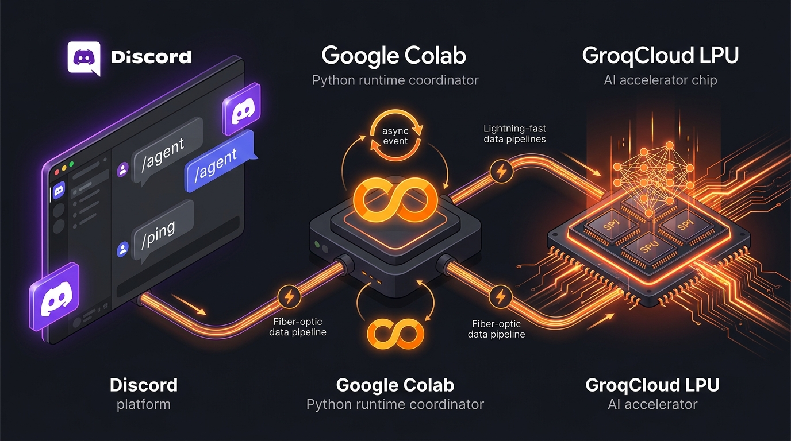

<div align="center">

# ⚡ SkillUp Discord AI Agent
### A Lightning-Fast, Permission-Aware Discord AI Assistant Powered by GroqCloud LPU Inference

[](https://www.python.org/)
[](https://discordpy.readthedocs.io/)
[](https://groq.com/)
[](https://colab.research.google.com/)
[](LICENSE)
[](#)

</div>

---

## 🌟 Overview

The **SkillUp Discord AI Agent** is an end-to-end conversational AI bot built for technical workshops, development teams, and community servers. It pairs the flexibility of **Discord's Slash Commands** with the ultra-low latency inference of **GroqCloud Language Processing Units (LPUs)**.

Unlike typical sluggish bots that suffer from Discord gateway timeouts, this bot implements production-grade engineering guards:
- **Instant Guild Syncing**: Bypasses Discord's 1-hour global cache propagation delay.
- **Asynchronous Deferral**: Neutralizes Discord's 3-second slash command timeout window.
- **Dynamic File Offloading**: Prevents crashes from Discord's 2,000-character payload limit by seamlessly packaging long LLM outputs into attached text files.
- **Private Channel Summarizer**: Scans authorized channels, extracts structured action items, and returns confidential summaries exclusively to users with `Manage Server` permissions via ephemeral delivery.

---

## 🏗️ 3-Tier Architecture

<div align="center">
  
</div>

```
[ Discord User ]
      │  Types slash command (/agent, /summary, /ping, /help)
      ▼
[ Discord Gateway / API ]
      │  Dispatches event over persistent WebSocket (WSS)
      ▼
[ Python Application ] (The Coordinator: bot.py or Colab)
      │  1. Verifies user role & channel visibility permissions
      │  2. Calls defer(thinking=True) to hold interaction window
      │  3. Sanitizes history & packages context prompt
      ▼
[ GroqCloud LPU ] (The Brain: qwen/qwen3.8-27b)
      │  Executes sub-second token generation
      ▼
[ Python Application ]
      │  Enforces 2,000-char limits (converts overflow to .txt stream)
      ▼
[ Discord User ] (Receives reply or ephemeral attachment)
```

For in-depth architectural details, see [**docs/ARCHITECTURE.md**](docs/ARCHITECTURE.md).

---

## ⚡ Slash Commands Reference

| Command | Arguments | Permissions | Behavior |
|---|---|---|---|
| `/ping` | *None* | Everyone | Verifies WebSocket connection with Discord gateway. Zero LLM consumption. |
| `/agent` | `prompt:<text>` | Everyone | Answers technical questions using Groq LLM. Auto-attaches `agent_answer.txt` if $>1850$ characters. |
| `/summary` | `messages_per_channel:[10-50]` | **Manage Server** (`manage_guild`) | Scans readable text channels, extracts decisions, action items, and delivers an ephemeral `.txt` digest. |
| `/help` | *None* | Everyone | Displays command listing and usage tips privately. |

---

## 📂 Repository Structure

```text
discord-groq-bot/
├── .github/workflows/
│   └── ci.yml                     # GitHub Actions CI quality & test pipeline
├── docs/
│   ├── ARCHITECTURE.md            # Deep-dive architecture and concurrency model
│   ├── SETUP_GUIDE.md             # Visual step-by-step credentials walkthrough
│   ├── TROUBLESHOOTING.md         # Diagnostic matrix for 401, 404, 429, timeouts
│   └── CONTRIBUTING.md           # Contribution guidelines & code standards
├── tests/
│   ├── conftest.py                # Environment fixtures
│   ├── test_config.py             # Secret parser & validation tests
│   └── test_bot_utils.py          # Message chunking & payload limit tests
├── SkillUp_Discord_AI_Agent.ipynb # Single-cell Google Colab notebook
├── bot.py                         # Standalone local & server execution script
├── test_credentials.py            # Pre-flight diagnostic checker
├── EXPLAINER_NOTES_AND_SCRIPT.md  # 10-minute workshop teaching script & mental model
├── Dockerfile                     # Non-root production container
├── docker-compose.yml             # Single-command VPS deployment
├── Makefile                       # Developer automation shortcuts
├── pyproject.toml                 # Ruff and modern Python tooling configuration
├── requirements.txt               # Locked production dependencies
├── .env.example                   # Environment variable template
├── .gitignore                     # Security filter preventing credential leaks
├── LICENSE                        # MIT License
└── README.md                      # Primary documentation
```

---

## 🚀 3-Minute Quickstart

### Prerequisites: The 3 Required Keys
1. **`DISCORD_BOT_TOKEN`**: From [Discord Developer Portal](https://discord.com/developers/applications) ➔ Applications ➔ Bot ➔ *Reset Token*. *(Ensure "Message Content Intent" is enabled under Privileged Gateway Intents!)*
2. **`GROQ_API_KEY`**: From [GroqCloud Console](https://console.groq.com/keys).
3. **`DISCORD_GUILD_ID`**: Right-click your Discord server icon (with Developer Mode enabled in User Settings ➔ Advanced) ➔ *Copy Server ID*.

For visual step-by-step instructions with screenshots, refer to [**docs/SETUP_GUIDE.md**](docs/SETUP_GUIDE.md).

---

### Option 1: Google Colab (Zero-Install Setup)
Ideal for presentations, interactive workshops, and quick testing without installing Python locally.

1. Open [`SkillUp_Discord_AI_Agent.ipynb`](SkillUp_Discord_AI_Agent.ipynb) in [Google Colab](https://colab.research.google.com/).
2. Click the **Key icon (🔑 Secrets)** on Colab's left sidebar and add:
   - `DISCORD_BOT_TOKEN`
   - `GROQ_API_KEY`
   - `DISCORD_GUILD_ID`
   *(Turn ON the toggle "Notebook access" for all three)*.
3. Click **Runtime ➔ Run All**. The bot logs in and connects instantly.

---

### Option 2: Local Environment

1. **Clone the repository**:
   ```bash
   git clone https://github.com/your-username/discord-groq-bot.git
   cd discord-groq-bot
   ```

2. **Set up virtual environment & install packages**:
   ```bash
   make install
   # Or manually:
   # python3 -m venv .venv && source .venv/bin/activate && pip install -r requirements.txt
   ```

3. **Configure environment variables**:
   ```bash
   cp .env.example .env
   ```
   Edit `.env` with your actual credentials:
   ```env
   DISCORD_BOT_TOKEN=your_bot_token_here
   GROQ_API_KEY=gsk_your_groq_api_key_here
   DISCORD_GUILD_ID=123456789012345678
   GROQ_MODEL=qwen/qwen3.8-27b
   ```

4. **Run pre-flight check**:
   ```bash
   make test-creds
   # or: python test_credentials.py
   ```
   *This checks Groq API inference and tests the Discord Gateway handshake before launching.*

5. **Start the bot**:
   ```bash
   make run
   # or: python bot.py
   ```

---

### Option 3: Docker & Docker Compose

Deploy easily on any Linux VPS (Render, Railway, Fly.io, DigitalOcean):

```bash
# 1. Fill in .env
cp .env.example .env

# 2. Build and launch container in background
make docker-up
# or: docker compose up -d --build

# 3. View live logs
docker compose logs -f
```

---

## 🧪 Testing & Code Quality

The project includes unit tests for configuration parsing, buffer limits, and sanitization logic:

```bash
# Run test suite
make test
# or: pytest

# Run linting
make lint
# or: ruff check .

# Auto-format
make format
# or: ruff format .
```

---

## 🛡️ Security & Least Privilege

- **No Hardcoded Credentials**: Variables are isolated via `.env` and Colab Secrets. `.gitignore` prevents unintentional commits.
- **Least Privilege Gateway Permissions**: The bot only requests `View Channels`, `Read Message History`, `Send Messages`, and `Attach Files`. No administrative rights required.
- **Confidential Summaries**: Channel summaries are strictly restricted to server managers and transmitted with `ephemeral=True` so they are never leaked in public channels.
- **Prompt Injection Defense**: Server channel history is formatted as passive **DATA** blocks, explicitly instructing the model to disregard command directives embedded within user messages.

---

## 🛠️ Troubleshooting

Encountering an issue? Check [**docs/TROUBLESHOOTING.md**](docs/TROUBLESHOOTING.md) for quick fixes:
- `PrivilegedIntentsRequired` ➔ Message Content Intent missing in Dev Portal.
- `401 Unauthorized` ➔ Invalid Groq API key or Discord token.
- `404 Model Not Found` ➔ Model identifier outdated; switch to fallback in `.env`.
- `Error 10062: Unknown Interaction` ➔ Discord 3-second timeout exceeded due to missing `defer()`.

---

## 📄 License

This project is licensed under the [MIT License](LICENSE).
